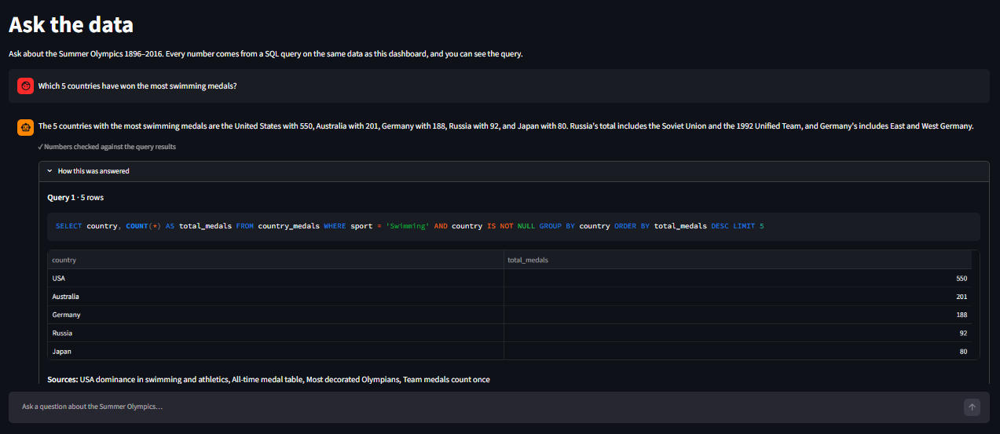
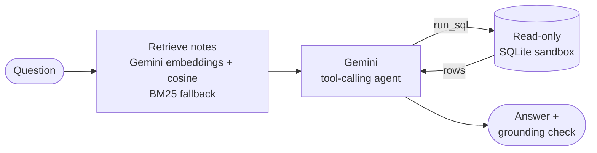

# 🏅 Olympics Analysis Dashboard

[](https://olympic-analysis-wbcngllnqyncsjv4agufpt.streamlit.app/)


[](https://public.tableau.com/app/profile/vishesh.sharma3888/viz/OlympicsMedalDashboard_17916664107200/OlympicsDashboard)

An interactive Streamlit dashboard that explores **120 years of Summer Olympics history** — medal tallies, country-wise performance, athlete demographics and participation trends. The same data is also analysed in **SQL** and visualised in **Tableau**, and an **AI assistant** answers plain-English questions about it with SQL it writes and runs itself.

**Live app:** https://olympic-analysis-wbcngllnqyncsjv4agufpt.streamlit.app/

**Tableau dashboard:** https://public.tableau.com/app/profile/vishesh.sharma3888/viz/OlympicsMedalDashboard_17916664107200/OlympicsDashboard

<!-- Add a screenshot here, e.g.  -->

---

## 🤖 Ask the data — AI assistant

The app has an **Ask the data** page: type a question in plain English, such as *"How did India do at London 2012?"*, and get a short answer computed from the same Olympic data as the dashboard. A Google Gemini model looks up the relevant background notes, writes its own SQL, runs it on a read-only copy of the data and answers with the numbers that came back. Under every answer you can see the SQL it ran, the rows it got and whether each number in the answer was found in those results.

**Try it:** open the [live app](https://olympic-analysis-wbcngllnqyncsjv4agufpt.streamlit.app/) and choose **Ask the data** in the sidebar.



### How it works



- **Retrieval (RAG):** five short notes on the dataset, its counting rules, key findings and terms are split into 43 sections and embedded with `gemini-embedding-001`. The 4 sections closest to the question by cosine similarity go to the model; if the question can't be embedded, BM25 keyword search takes over. Every statistic in the notes is checked against SQL by the tests.
- **Tool-calling agent:** Gemini gets the notes, its rules and one tool, `run_sql`. It writes SQLite `SELECT` queries against two views that encode the counting rules (Summer Games only, duplicate rows removed, a team medal counted once per country), reads the result and answers in a few sentences. Each question gets at most 3 queries and 5 Gemini calls, and the app runs the tool loop itself, so every query is recorded.
- **Grounding check:** every number in the answer must appear in this question's query results or notes. The page shows "✓ Numbers checked against the query results" or lists the numbers it couldn't verify; the check flags an answer, it never blocks one.
- **Shows its work:** a "How this was answered" panel lists each SQL query with its rows, the notes used, the retrieval method, the model, the number of Gemini calls and the time taken.
- **Stays in scope:** answers avoid SQL jargon, mention a counting rule only when it changes the number (for example, Russia's total including the Soviet Union), and questions about the Winter Games, Games after Rio 2016, opinions or predictions get a short explanation and a suggested question instead.

### Evaluation

An evaluation set of 41 questions with SQL-verified expected answers (key findings, new SQL questions, explanations, out-of-scope, safety, Hinglish and follow-up questions) is scored automatically: correct numbers and names, SQL used when needed, refusals, grounding, language and plain English. Results at commit `a0dab7b` ([full report](chatbot/eval/REPORT.md)):

| Split | Questions | Baseline | Final | Grounded (final) | Median latency (final) |
| --- | --- | --- | --- | --- | --- |
| dev — tuned on | 23 | 12/23 | 21/23 (91%) | 23/23 | 4.1 s |
| old test — tuned on¹ | 10 | 6/10 | 8/10 (80%) | 10/10 | 3.3 s |
| **dev + old test** | **33** | **18/33 (55%)** | **29/33 (88%)** | 33/33 | 3.9 s |
| **test2 — held out²** | **8** | – | **8/8 (n = 8)** | 8/8 | 3.6 s |

¹ Meant to be held out, but one of its failures led to a change in the notes, so it counts as tuned on.
² Written after the last change and run once.

The baseline is the first version (temperature 0); the final version has prompt fixes, plain-English notes and temperature 1.0. Latency is the Gemini calls plus SQL per question on the free tier. The sets are small — 41 questions, only 8 of them held out — so they show the assistant works on typical questions rather than measure a precise accuracy. The prompt has had small fixes since `a0dab7b`, spot-checked on the affected questions; the table has not been re-run.

### Safety & cost

- **Read-only SQL sandbox:** the model's SQL runs on a separate copy of the data opened read-only, through an SQLite authorizer that allows only reads, with exactly one statement per query, a 5-second timeout and a 200-row cap (at most 50 rows go back to the model). Tests check that writes such as `DELETE` or `DROP` are rejected and the data is unchanged.
- **Injection guards:** notes and query results are passed to the model as data, not instructions, and requests to change data or reveal the instructions get one fixed reply.
- **API key only in secrets:** `GEMINI_API_KEY` is read from Streamlit Cloud Secrets, or locally from a git-ignored `.streamlit/secrets.toml`; it is not in the code or the repository.
- **Free tier with fallbacks:** answers come from free-tier Gemini models in a chain (`gemini-3.5-flash-lite` → `gemini-3.1-flash-lite` → `gemini-3.8-flash`); a model that runs out of quota is skipped for 5 minutes and the next one answers.
- **Usage limits:** 15 questions per browser session, 200 per day for the whole app and 3 seconds between questions, each configurable. Questions are sent to Google Gemini to be answered and are kept only in the browser session; the app doesn't log or store them.

### Limitations

- Covers the Summer Games 1896–2016 only, like the dataset; the Winter Games and later Games are out of scope.
- Runs on the Gemini free tier: when the daily quota or the app's daily limit is used up, the page asks visitors to come back later.
- Answers can be wrong, which is why the SQL is shown. Known open issues: explanation questions sometimes run an unneeded `SELECT 1` query; an answer can round loosely (24 for an average of 23.6), add a counting rule it didn't need or, rarely, name an internal view; and the model occasionally emits stray text (once, a "2>" inside a year on the live app).

### Run it locally

Needs Python 3.11 or newer and a Gemini API key (free from Google AI Studio). Put the key in `.streamlit/secrets.toml`, which git ignores:

```toml
GEMINI_API_KEY = "your-gemini-api-key"
```

```bash
pip install -r requirements.txt
streamlit run app.py                  # then choose "Ask the data" in the sidebar
pip install -r requirements-dev.txt   # adds pytest
python -m pytest -q                   # offline tests; the live Gemini tests are skipped
python -m pytest -m live -q           # live Gemini tests: these use free-tier quota
```

Without a key, the dashboard pages still work and Ask the data says it isn't configured.

---

## Features

### 🥇 Medal Tally
- Filter by year, by country, or both
- Gold, silver, bronze and total medal cards, with the full medal table

### 📊 Overall Analysis
- Key figures: Olympic editions, host cities, sports, events, nations and athletes
- Auto-generated **"Did You Know?"** facts: youngest gold medalist, oldest medalist, most decorated athlete, the nation with the most golds and the biggest Games by participation
- Participating nations, events and athletes over time
- **Choropleth world map** of medals by country, for any single year or overall
- **Animated medal race** of the top 10 nations, building cumulative totals across every Games
- Heatmap of events per sport across the years
- Top 15 most successful athletes, overall or by sport

### 🌍 Country-Wise Analysis
- Medal tally over the years for any country
- Sport-wise medal performance heatmap
- Top 10 athletes of the selected country

### 🏃 Athlete-Wise Analysis
- Age distribution of medalists by medal type
- Age distribution of gold medalists across sports
- Height vs. weight of athletes by sport, colored by medal and styled by sex
- Male vs. female participation over time

### 🤖 Ask the data
- Plain-English questions answered with SQL that Gemini writes and runs on a read-only copy of the data
- One-click example questions, chat history, and a "How this was answered" panel with every query and its rows
- A grounding line under each answer that says whether its numbers match the query results
- Hinglish questions get Hinglish answers
- See [Ask the data — AI assistant](#-ask-the-data--ai-assistant) for how it works and how it was evaluated

## SQL Analysis

Ten business questions answered in SQL — all-time medal table, India's performance at every Games, the top nation per Games, women's participation, the most decorated athletes, medal conversion rates and more. The queries use CTEs, window functions (`RANK`, `LAG`, `SUM OVER`), conditional aggregation and `HAVING`, run unchanged on **SQLite and MySQL 8**, and return the same numbers as the dashboard.

```bash
python sql/load_sqlite.py    # build a local SQLite database
python sql/run_queries.py    # print all ten results
```

See [`sql/README.md`](sql/README.md) for the questions, key findings and MySQL instructions.

## Tableau Dashboard

An interactive [Tableau Public dashboard](https://public.tableau.com/app/profile/vishesh.sharma3888/viz/OlympicsMedalDashboard_17916664107200/OlympicsDashboard) with a medal map, the top 10 countries, medals over time, the top 15 sports and women's participation. Year and Country filters update every medal chart, and clicking a country on the map shows its medals over time and its own strongest sports.

`tableau/prepare_data.py` builds the tidy CSVs behind it (team medals counted once, map-ready country names). See [`tableau/README.md`](tableau/README.md) for how it is built.

## Tech Stack

| Layer | Tools |
| --- | --- |
| App framework | Streamlit |
| Data processing | pandas, NumPy |
| Interactive charts | Plotly (line charts, choropleth map, animated bar race, histograms) |
| Statistical plots | Matplotlib, Seaborn (heatmaps, scatter plots) |
| SQL | SQLite, MySQL 8 (CTEs, window functions) |
| BI dashboard | Tableau Public |
| AI assistant | Google Gemini via `google-genai`: `gemini-embedding-001` embeddings, function calling with a free-tier model chain |
| Retrieval | NumPy cosine similarity over a committed embeddings index, BM25 keyword fallback |
| Testing | pytest (offline tests plus opt-in live Gemini tests), Streamlit AppTest, an automatic evaluation set |

## Dataset

[120 years of Olympic history: athletes and results](https://www.kaggle.com/datasets/heesoo37/120-years-of-olympic-history-athletes-and-results) (Kaggle):

- `athlete_events.csv` — athlete-level results for each event
- `noc_regions.csv` — National Olympic Committee codes mapped to regions

Both files are included in this repository.

## Project Structure

```
olympic-analysis/
├── app.py               # Streamlit app: navigation, layout and charts
├── preprocessor.py      # Loads, merges and prepares the dataset
├── helper.py            # Analysis functions: medal tallies, trends, facts, map and race data, top athletes
├── athlete_events.csv   # Athlete-level results
├── noc_regions.csv      # NOC code → region mapping
├── sql/                 # Schema, loaders (SQLite, MySQL) and ten analysis queries
├── tableau/             # Data preparation and CSVs for the Tableau dashboard
├── chatbot/             # Ask the data: Gemini client, retrieval, agent, sandboxed SQL, Streamlit page
│   ├── knowledge/       # Curated notes for retrieval (every statistic checked against SQL)
│   ├── index/           # Committed embeddings index of the notes
│   └── eval/            # Evaluation set, runner, results and REPORT.md
├── tests/               # pytest tests: SQL sandbox, notes, retrieval, agent, UI, evaluation
├── assets/              # README screenshots
├── requirements.txt     # App dependencies
└── requirements-dev.txt # App dependencies + pytest
```

## Run Locally

```bash
git clone https://github.com/vishesharma14/olympic-analysis.git
cd olympic-analysis
pip install -r requirements.txt
streamlit run app.py
```

The app opens at http://localhost:8501. It needs Python 3.11 or newer; to use **Ask the data**, add a Gemini API key first (see [Run it locally](#run-it-locally)).

## Author

**Vishesh Sharma** · [GitHub](https://github.com/vishesharma14)
